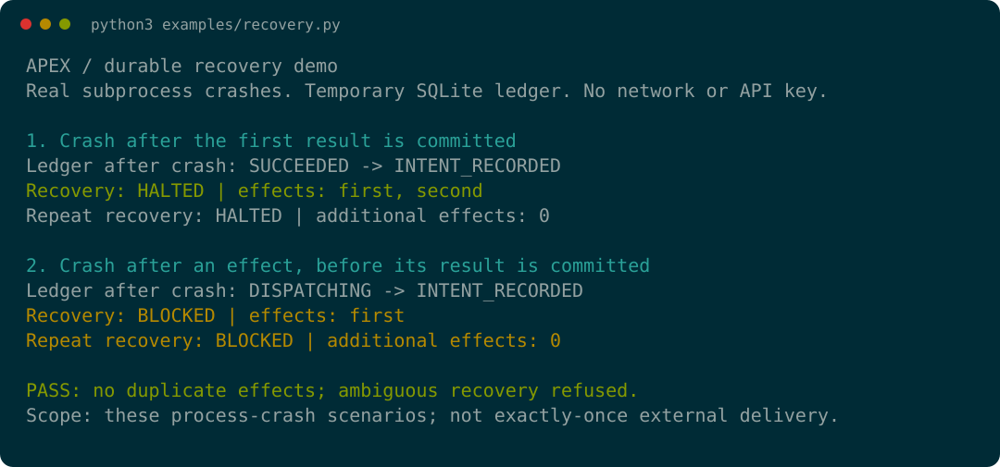
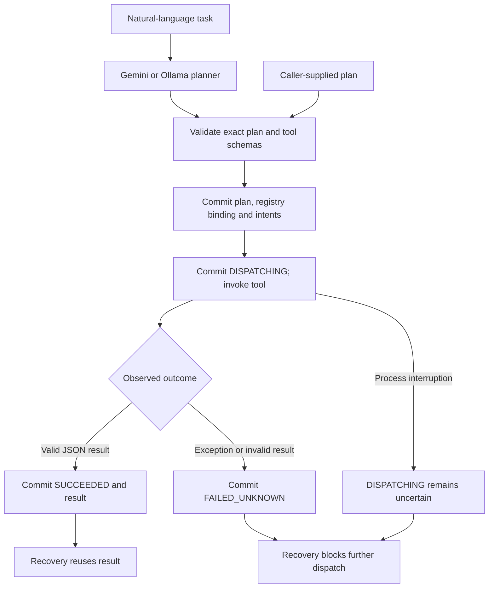

# APEX

**Advanced AI execution infrastructure: durable plans, policy-bound tool execution, crash recovery and controlled replay.**

APEX turns a natural-language task or an explicit plan into schema-validated,
bounded tool calls. A SQLite effect ledger records dispatch and observed results,
so recovery can reuse completed work without asking a model to reconstruct it.

[](https://github.com/axiom-llc/axiom-apex/actions/workflows/ci.yml)
[](pyproject.toml)
[](LICENSE)

[Try the demo](#try-the-recovery-demo) · [How it works](#how-it-works) · [Install](#install) · [Documentation](#documentation)

## Integrated platform

[ASON, Harness and API](packages/) bring policy enforcement, durable orchestration and HTTP transport into this workspace as separately installable packages. [Provenance](packages/SOURCES.json) pins their original source revisions; [platform CI](.github/workflows/platform.yml) validates installation and integration.

## Why APEX

A tool can change external state and then time out before returning a result.
Blindly repeating that call can repeat the effect. APEX makes that uncertainty
explicit rather than treating a missing response as proof that nothing happened.

| Engineering concern | APEX behavior |
| --- | --- |
| Invalid or drifting tool contracts | Validate the whole plan against the active registry; bind its schema contract before dispatch. |
| Recovery after interruption | Reuse recorded successful results; continue only where durable evidence permits. |
| Ambiguous side effects | Block recovery on `DISPATCHING` or `FAILED_UNKNOWN`. |
| Unbounded execution | Limit plans to 32 steps, calls to 300 seconds, and serialized tool output to 10 MiB. |
| Inspectability | Retain accepted plans, tool events and results; expose history, export, tracing and replay. |
| Caller-selected authorization | Integrate with ASON through an exact-plan authorization binding. |

Use it to study or build inspectable tool workflows, agent execution services,
and recovery-aware integrations. Natural-language planning remains model-dependent;
the execution and recovery rules are explicit. APEX is not an exactly-once delivery
system or a general-purpose sandbox for arbitrary tools.

## Try the recovery demo

**No API key, model server, package installation or network access is needed after
checkout.** Use Python 3.11 or 3.12 on Linux/macOS; the execution loop uses POSIX
signals. Windows users need a Linux environment such as WSL.

```bash
git clone https://github.com/axiom-llc/axiom-apex.git
cd axiom-apex
python3 examples/recovery.py
```

The example calls the real execution kernel and SQLite ledger with a synthetic
append tool. It kills a child process at two boundaries, recovers the same run
twice, and checks the resulting effects. All data stays in a temporary directory
that is removed on completion; your configured APEX databases are not used.



<details>
<summary>Expected output (also available as a plain-text transcript)</summary>

```text
APEX / durable recovery demo
Real subprocess crashes. Temporary SQLite ledger. No network or API key.

1. Crash after the first result is committed
Ledger after crash: SUCCEEDED -> INTENT_RECORDED
Recovery: HALTED | effects: first, second
Repeat recovery: HALTED | additional effects: 0

2. Crash after an effect, before its result is committed
Ledger after crash: DISPATCHING -> INTENT_RECORDED
Recovery: BLOCKED | effects: first
Repeat recovery: BLOCKED | additional effects: 0

PASS: no duplicate effects; ambiguous recovery refused.
Scope: these process-crash scenarios; not exactly-once external delivery.
```

</details>

[Source](examples/recovery.py) · [Transcript](docs/assets/recovery.txt) ·
[Terminal recording](docs/assets/recovery.cast) (`asciinema play docs/assets/recovery.cast`)

This is a focused kernel example, not an LLM benchmark. The subprocess fault
injection is confined to the example; it does not change the runtime. Its checks
demonstrate these process-crash cases, not host-power-loss guarantees.

## How it works



The accepted plan and planner-visible tool contract are SHA-256 bound to the run.
Recovery validates those bindings before dispatch; it does not regenerate the
plan or rerun the planner. A registry binding detects interface drift, not changes
to tool implementation code or external services.

| Durable state | Meaning on recovery |
| --- | --- |
| `INTENT_RECORDED` | Dispatch has not begun; the step may execute after validation. |
| `SUCCEEDED` | Reuse the recorded result without calling the tool again. |
| `DISPATCHING` | The effect may have occurred; block the run. |
| `FAILED_UNKNOWN` | Failure does not prove absence of an effect; block the run. |

Any uncertain step blocks all further dispatch in that recovery. See the
[execution and recovery contract](docs/execution.md) for the full semantics.

## Install

The demo above runs directly from source. The full CLI, server, provider adapters
and RAG integrations require the package dependencies.

| Version | Availability | Compatibility |
| --- | --- | --- |
| APEX **3.1.1** | Published GitHub release baseline | Install with RAG 1.5.0; does not satisfy ASON 0.3.0. |
| APEX **3.2.0** | Current source; unreleased | Required by ASON 0.3.0; use matching RAG 1.5.0 source. |

**The legacy PyPI package does not contain this architecture.** A bare
`pip install axiom-apex` is not the installation route for this source.

For the current source, check out matching RAG 1.5.0 alongside this repository,
then run from `axiom-apex/`:

```bash
python3 -m venv .venv
source .venv/bin/activate
python -m pip install ../axiom-rag -e '.[dev]'
python -m pip check
```

Use the [installation guide](docs/installation.md) for the exact published-wheel
commands and container setup. [RELEASE.md](RELEASE.md) covers checksums and the
remaining 3.2.0 release gates. This README update does not publish a release.

## Run

For natural-language planning, configure Gemini with `GEMINI_API_KEY`, or set
`LLM_PROVIDER=ollama` and `OLLAMA_MODEL` to a model installed on your reachable
Ollama server. See [configuration](docs/configuration.md) for all settings.

```bash
apex --dry-run "write 'hello world' to /tmp/out.txt and read it back"
apex "write 'hello world' to /tmp/out.txt and read it back"
apex history
apex replay 42 --mode simulate
apex replay 42 --mode dry
```

Replace `42` with an actual run ID. `simulate` prints recorded events; `dry`
prints the stored plan. `apex replay 42 --mode live` attempts recovery of that
same run and can execute steps whose dispatch has not begun. Submitting a plan
again creates a new run and can repeat effects; submission is not deduplicated.

For exact plans without a planning call, use Python's `run_plan` as shown in the
demo or the server's `POST /run` plan interface. The [HTTP guide](docs/integrations.md)
documents request shapes, authentication and authorized execution.

## Safety and operating boundaries

- **Trusted tools:** custom tools run with the executor's privileges. The RSI
  experiment's isolation boundary does not sandbox ordinary tool calls.
- **Explicit authorization:** `--audit` is an advisory pre-execution check.
  A trusted application must enforce ASON policy and prevent direct APEX bypass.
- **Conservative recovery:** no automatic reconciliation, compensation,
  transactional rollback or multi-process recovery coordination is provided.
  Operate recovery with one executor and the same trusted tool implementations.
- **Result semantics:** `SUCCEEDED` means acceptable JSON was returned, not that
  an external business operation was independently verified.
- **Retries:** custom tools default to one attempt. Only tools explicitly marked
  `retry_safe=True` receive bounded in-process retries; uncertain restart recovery
  remains blocked.
- **HTTP exposure:** require `APEX_API_KEY` before non-loopback binding. The
  Flask server runs single-threaded because tool timeouts use main-thread signals.

## Documentation

<!-- Preserve established README fragments after moving the detailed reference. -->
<a id="configure"></a>
<a id="architecture"></a>
<a id="planning-and-execution"></a>
<a id="safety"></a>
<a id="replay"></a>
<a id="http-api"></a>
<a id="mcp"></a>
<a id="rag"></a>
<a id="exact-plan-submission"></a>
<a id="rsi-experiment"></a>
<a id="test"></a>
<a id="container"></a>
<a id="ecosystem"></a>
<a id="provider-boundary-checks"></a>

| Guide | Contents |
| --- | --- |
| [Installation](docs/installation.md) | Published wheels, source dependencies, container credentials and persistence |
| [Configuration](docs/configuration.md) | Provider, model, history, MCP and RAG environment variables |
| [Execution and recovery](docs/execution.md) | Validation, limits, audits, ledger states, replay and recovery boundaries |
| [Integrations](docs/integrations.md) | HTTP routes, exact plans, authorization, MCP and RAG contracts |
| [Development](docs/development.md) | CLI reference, source layout, testing, benchmarks and provider checks |
| [RSI experiment](docs/rsi.md) | Candidate evaluation, kernel isolation, resource limits and manual review |
| [Release gates](RELEASE.md) | Distribution compatibility and release verification |

## Verify

The standalone demo and its regression check need only the standard library:

```bash
python3 examples/recovery.py
python3 tests/test_recovery_demo.py
```

After installing development dependencies:

```bash
python -m pytest tests/test_effect_ledger.py tests/test_recovery_demo.py -q
python -m compileall -q apex examples benchmarks tests
```

The [CI workflow](.github/workflows/ci.yml) runs the offline suite, real kernel
isolation probes, package build and installed-package smoke checks. The full
suite needs the Linux/Bubblewrap/systemd prerequisites in the [RSI guide](docs/rsi.md).
Live-provider integration tests are separate. Mock benchmark scores are not
evidence of live-model performance or customer deployment.

## Related projects

| Project | Responsibility |
| --- | --- |
| [ASON](https://github.com/axiom-llc/axiom-ason) | Caller-selected policy and exact-plan authorization |
| [RAG](https://github.com/axiom-llc/axiom-rag) | Retrieval/storage implementation and HTTP adapters |
| [Demos](https://github.com/axiom-llc/axiom-demos) | Applied integration examples |
| [Research](https://github.com/axiom-llc/axiom-research) | Architecture and technical research |
| [AXIOM portfolio](https://axiom-llc.github.io) | Broader engineering work |

Independent engineering and R&D by AXIOM. [MIT license](LICENSE).
